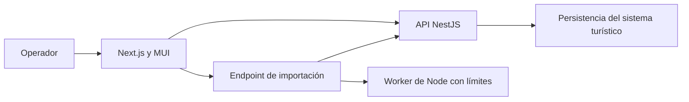

# Arquitectura de Web Turismo Admin

## Sistema y fronteras

La web es un cliente operativo separado de la app turística. Consume la API
NestJS existente. Su único endpoint propio analiza una ficha Excel y devuelve
datos para el editor; no persiste la ficha ni publica contenido.

| Frontera                       | Responsabilidad en este repositorio                                 |
| ------------------------------ | ------------------------------------------------------------------- |
| Navegador → API                | Cliente tipado, sesión institucional, errores y caché privada       |
| Navegador → Next.js            | Páginas dinámicas, cabeceras y CSP por respuesta                    |
| Archivo → importación          | Identidad consultada a la API, cuotas, límites y validación ZIP/XML |
| Endpoint → worker              | Cancelación, transferencia de bytes, memoria y plazo acotados       |
| API → datos, roles y auditoría | Contrato externo; no se replica en la web                           |
| Build → despliegue             | Standalone, archivos de entorno excluidos y usuario `node`          |

## Mapa del código

| Ruta                                                      | Propósito                                                            |
| --------------------------------------------------------- | -------------------------------------------------------------------- |
| `src/app/`                                                | Rutas, metadatos y composición del servidor                          |
| `src/proxy.ts`                                            | Nonce y política de seguridad para las páginas                       |
| `src/components/admin/`                                   | Flujos de fichas, catastro, catálogos y revisión                     |
| `src/components/ui/`                                      | Componentes operativos compartidos y campos de formulario            |
| `src/lib/admin-api.ts`, `http.ts`                         | Contratos y transporte hacia la API                                  |
| `src/lib/admin-queries.ts`                                | Claves, frescura e invalidación de TanStack Query                    |
| `src/lib/admin-session.ts`, `auth.tsx`, `auth-browser.ts` | Ciclo de sesión y sincronización entre pestañas                      |
| `src/lib/center-sections/`                                | Definiciones y conversiones de los 14 apartados                      |
| `src/lib/ficha/`, `src/workers/`                          | Análisis seguro de la ficha MINTUR                                   |
| `src/theme.ts`, `src/theme/tokens.ts`                     | Identidad visual, componentes MUI y escalas                          |
| `tests/`, `e2e/`                                          | Evidencia automatizada existente, con API simulada donde corresponde |
| `docs/`, `openspec/`, `.agents/skills/`                   | Knowledge, comportamiento y procedimientos                           |

## Dependencias

Las rutas componen los flujos; los flujos consumen componentes compartidos y
clientes de `src/lib`. `src/lib` no importa desde `src/components`.
Las conversiones de dominio no conocen MUI, Next.js ni almacenamiento remoto.
El código del navegador no importa el parser ni el worker de Node.

El estado remoto pertenece a TanStack Query, el formulario a React Hook Form,
la navegación compartible a la URL y los overlays a su estado local. Una respuesta
de una generación de sesión anterior no puede entrar en la caché actual.

## Lecturas siguientes

- [Índice técnico](docs/architecture/index.md).
- [Stack conservado](docs/architecture/stack.md).
- [Contrato con la API](docs/architecture/backend.md).
- [Interfaz y componentes](docs/architecture/frontend.md).
- [Controles vigentes](docs/security/controles.md).
- [Adopción de CognitiveStack](docs/architecture/cognitivestack-adoption.md).
